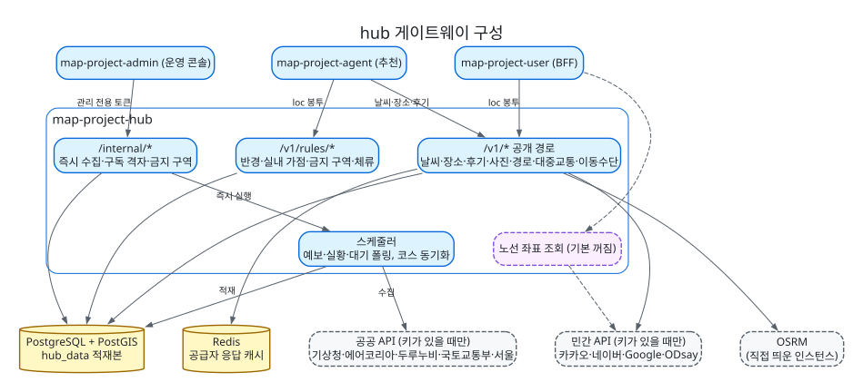
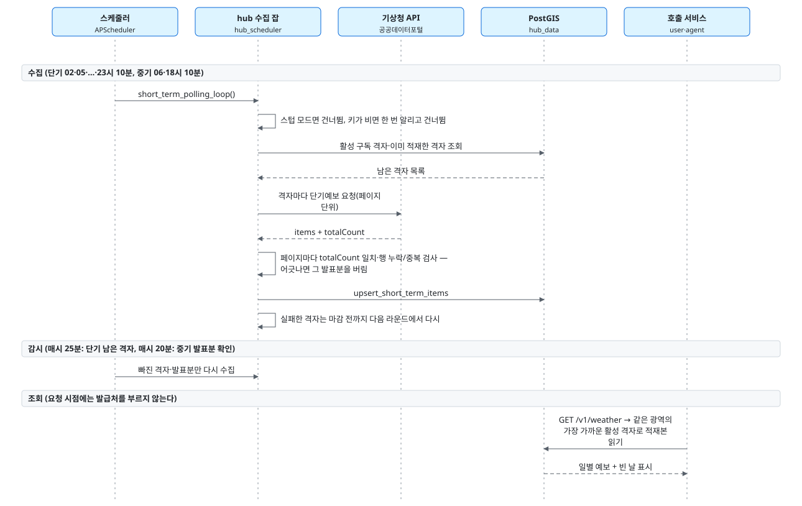
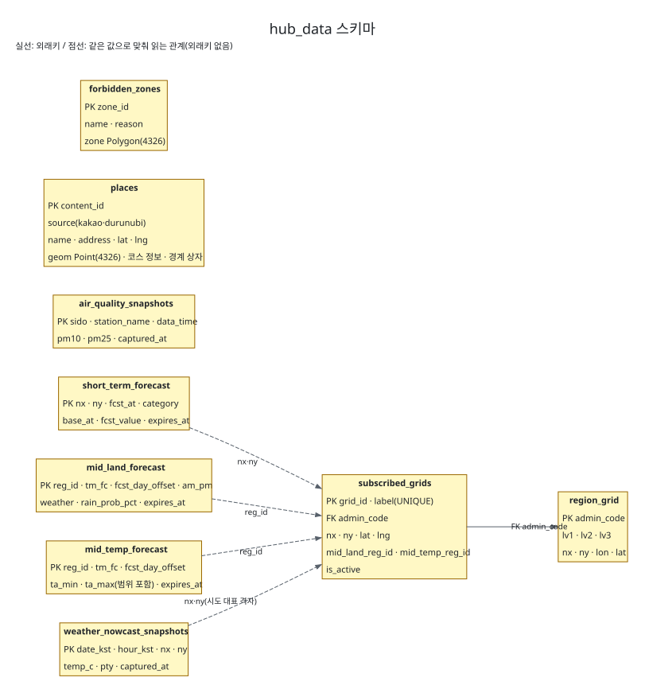

# map-project-hub

MAP 의 외부 데이터 게이트웨이. 관광·날씨·장소·경로·이동수단 자료를 외부 API 에서 받아 정해진 모양으로 바꿔 다른 서비스에 내준다(FastAPI · PostgreSQL/PostGIS · Redis · APScheduler).

## 저장소 지도

MAP 는 일곱 저장소로 이루어져 있다. 전체 구조와 한 번에 실행하는 방법은 [map-project-infra](https://github.com/we-meet-trip/map-project-infra) 에서 시작한다.

| 저장소 | 역할 |
|---|---|
| [map-project-infra](https://github.com/we-meet-trip/map-project-infra) | 전체 안내, 로컬 실행 구성(Docker Compose), DB 초기화 |
| [map-project-client](https://github.com/we-meet-trip/map-project-client) | 모바일 앱(Flutter, iOS·Android) |
| [map-project-user](https://github.com/we-meet-trip/map-project-user) | 사용자 BFF(Spring Boot): 인증·일정·채팅·동의, 다른 서비스 중계 |
| [map-project-agent](https://github.com/we-meet-trip/map-project-agent) | 추천 에이전트(FastAPI·LangGraph): 장소·경로·일정 생성 |
| **[map-project-hub](https://github.com/we-meet-trip/map-project-hub)** | **외부 데이터 게이트웨이(FastAPI·PostGIS): 관광·날씨·장소·경로** |
| [map-project-yolo](https://github.com/we-meet-trip/map-project-yolo) | 비전 서비스(WebSocket, 객체 탐지 + LLM 식별) |
| [map-project-admin](https://github.com/we-meet-trip/map-project-admin) | 운영 콘솔(FastAPI·React) |

## 이름의 뜻

`hub` 는 여러 외부 공급자를 한곳에 모으는 게이트웨이라는 뜻이다. 다른 서비스는 외부 API 를 직접 부르지 않고 이 서비스를 거친다. 그래서 키·호출 한도·캐시·실패 처리가 한곳에 모인다.

## 개요

- 기상청 예보는 정해 둔 격자만 주기적으로 받아 PostGIS 에 적재하고, 조회는 적재본만 읽는다. 발급처가 느리거나 멈춰도 날씨 조회는 느려지지 않는다.
- 장소·후기·사진·대중교통·따릉이·킥보드는 요청 때 공급자를 부르고 Redis 에 캐시한다. **키를 넣은 공급자만 부른다.**
- 서비스 사이를 오가는 좌표는 AES-GCM 봉투(`loc`)로만 받는다. 평문 좌표를 받는 길은 없다.
- 공급자 실패는 빈 성공 값으로 꾸미지 않고 `status` 나 503 으로 드러낸다.
- 외부 호출이 없는 결정적 규칙(이동수단 반경, 실내 가점, 금지 구역, 체류 시간)도 여기서 계산한다.

## 아키텍처

<picture>
  <source media="(prefers-color-scheme: dark)" srcset="docs/diagrams/gateway-dark.svg">
  
</picture>

처리 순서·모듈 역할·기동 검사·스케줄러·DB 역할·타임아웃은 [docs/architecture.md](docs/architecture.md) 에 있다. 설계 결정은 [docs/decisions/](docs/decisions/) 에 있다.

<picture>
  <source media="(prefers-color-scheme: dark)" srcset="docs/diagrams/kma-polling-dark.svg">
  
</picture>

## 기능

| 기능 | 경로 | 자료 |
|---|---|---|
| 날씨 예보(기간) | `GET /v1/weather` | 기상청 단기·중기 예보 적재본 |
| 현재 날씨·어제 비교·미세먼지 | `GET /v1/weather/now` | 기상청 초단기실황·에어코리아 적재본 |
| 지역 장소·걷기/자전거 코스 | `GET /v1/places` | 카카오 로컬, 두루누비 |
| 주소 검색 | `GET /v1/places/address` | 카카오 로컬 |
| 주변 장소(응답도 봉투) | `GET /v1/places/nearby` | 카카오 로컬 |
| 블로그 후기 | `GET /v1/reviews` | 네이버 검색 |
| 장소 사진(주소와 저작자 표시만) | `GET /v1/places/photos` | Google Places |
| 도보·자전거 경로 | `POST /v1/directions/batch` | OSRM |
| 지하철·대중교통 경로, 노선 좌표 | `GET /v1/transit/subway`, `GET /v1/transit/routes`, `POST /v1/transit/routes/lane`(기본 꺼짐) | ODsay |
| 따릉이 대여소·공유 킥보드 | `GET /v1/mobility/bike-stations`, `GET /v1/mobility/pm-vehicles` | 서울 열린데이터광장, 국토교통부 |
| 규칙 계산 | `POST /v1/rules/*` | 외부 호출 없음(금지 구역은 PostGIS) |
| 관리(운영 콘솔 전용) | `/internal/*` | 즉시 수집, 구독 격자, 금지 구역 |

## 빠른 시작

### 통합 실행 (권장)

다른 서비스와 함께, 외부 키·비용 없이 띄우는 방법은 [map-project-infra](https://github.com/we-meet-trip/map-project-infra) 의 빠른 시작을 따른다. 그 구성은 좌표 봉투 열쇠와 DB 비밀번호를 만들고, hub 의 DB 역할을 준비하고, 마이그레이션을 한 번 돌린 뒤 hub 를 스텁 모드로 띄운다.

### 시험만 돌리기 (DB·네트워크 없이)

```bash
python3.12 -m venv .venv && . .venv/bin/activate
pip install -r requirements.txt -r requirements-dev.txt
python -m pytest -q
```

### hub 만 따로 띄우기

PostgreSQL(PostGIS 확장 포함)이 필요하고 Redis 를 권한다(Redis 가 끊겨도 조회는 캐시 없이 돌지만 `/health/ready` 는 503 이 된다). 순서는 [docs/architecture.md](docs/architecture.md) 5절과 같다.

1. 운영자 계정으로 PostGIS 확장을 만들고 `psql -f scripts/database-roles.sql` 로 역할을 만든 뒤, `map_hub_migrator`·`map_hub_runtime` 의 로그인 비밀번호를 정한다.
2. 빈 DB 라면 `map_hub_owner` 에게 DB CREATE 권한을 잠깐 주고 마이그레이션을 돌린 뒤 거둔다:
   `HUB_MIGRATION_DATABASE_URL=postgresql+psycopg://map_hub_migrator:<비밀번호>@<호스트>/<DB> python -m map_project_hub.db.migrate`
3. `psql -f scripts/database-roles.sql` 을 한 번 더 적용해 새 테이블에 런타임 권한을 준다.
4. `.env.example` 을 `.env` 로 복사하고 `HUB_DATABASE_URL`(런타임 역할), `MAP_PROJECT_LOCATION_WIRE_KEY`(`openssl rand -base64 32`)를 채운다. 키 없이 화면을 확인하려면 `HUB_PLACES_STUB_MODE=true` 를 더한다.
5. `uvicorn map_project_hub.main:app --port 8001` — 기동 검사(열쇠·역할·리비전)를 통과하지 못하면 이유를 남기고 멈춘다.

**`HUB_AUTH_ENFORCED` 는 로컬 실행용으로 기본 꺼짐이다. 외부에 열기 전에는 반드시 `HUB_AUTH_ENFORCED=true` 로 켜고 `MAP_PROJECT_INTERNAL_SERVICE_TOKEN`·`MAP_PROJECT_HUB_ADMIN_INTERNAL_TOKEN`·키를 직접 정해 넣는다.**

## 설정

모든 설정은 환경변수다. 목록과 설명은 [.env.example](.env.example) 에 있다.

- hub 만 읽는 값은 `HUB_` 접두(`HUB_ODSAY_API_KEY` 등), 여러 서비스가 함께 읽는 키·주소·토큰은 `MAP_PROJECT_` 접두(`MAP_PROJECT_KMA_SERVICE_KEY`, `MAP_PROJECT_LOCATION_WIRE_KEY` 등)다.
- 키가 비어 있는 공급자는 부르지 않는다. 수집 잡은 처음 한 번만 알리고 건너뛴다.
- 조정값(타임아웃·캐시 수명·하루 호출 상한)은 기본값이 있고 [docs/architecture.md](docs/architecture.md) 7절에 정리돼 있다.

## 데이터

레포에는 기상청이 공공누리 제1유형으로 개방한 자료 두 가지(행정구역·예보 격자 대응표, 중기 예보 구역코드)가 출처와 함께 들어 있다. 이 자료는 MIT 가 아니라 원래 이용조건을 따른다. 그 밖의 자료는 실행 중에 운영자의 키로 받는다. 출처·이용조건·스키마·한계는 [docs/data.md](docs/data.md) 에 있다.

<picture>
  <source media="(prefers-color-scheme: dark)" srcset="docs/diagrams/hub-data-erd-dark.svg">
  
</picture>

## API 와 계약

경로·좌표 봉투 형식·오류 형식·길이 한도·호출하는 서비스는 [docs/contracts.md](docs/contracts.md) 에 있고, 필드 단위 스키마는 실행 중인 서비스의 `/docs`(OpenAPI)가 기준이다.

- 좌표는 `loc` 봉투로만 받는다(`v1.<iv>.<암호문>`, AES-256-GCM, 300초 유효). 봉투가 없거나 틀리면 400.
- `POST /v1/rules/filter/forbidden-zones` 는 지금 부르는 서비스가 없어 실제 호출로는 검증되지 않았다.

## 폴더 구조

```
map-project-hub/
├── map_project_hub/      # 서비스 코드
│   ├── main.py           # 앱·기동 검사·스케줄러 시작
│   ├── config.py         # 환경변수 설정
│   ├── routers/          # 공개·규칙·내부 경로, 좌표 봉투 열기
│   ├── clients/          # 외부 API 어댑터
│   ├── scheduler/        # 수집·감시·정리 잡, 키 확인
│   ├── db/               # 저장소 접근, 마이그레이션 실행, 기동 DB 검사
│   ├── crypto/           # 좌표 봉투
│   ├── rules/ · schemas/ · codes/ · utils/ · cache/
│   └── place_stubs.py · route_stubs.py   # 명시 스텁 모드용 고정 응답
├── migrations/           # Alembic 리비전과 격자 시드
├── scripts/              # 역할 SQL, DB 계약 검사, 다이어그램 렌더
├── tests/                # 오프라인 단위 시험
└── docs/                 # 아키텍처·데이터·계약·트러블슈팅·결정·다이어그램
```

## 테스트

```bash
python -m pytest -q
```

DB·Redis·외부 API 없이 돈다(공급자는 가짜 전송, 좌표 봉투는 시험 전용 합성 열쇠). CI 는 Python 3.12·3.13 에서 단위 시험을 돌리고, 빈 PostGIS 서비스 컨테이너에서 실제 마이그레이션과 런타임 권한 거부를 검사한다(`scripts/verify-postgres-contract.py`).

## 트러블슈팅과 교훈

만들며 실제로 겪은 문제와 교훈은 [docs/troubleshooting.md](docs/troubleshooting.md) 에 있다. 예: 적재 격자와 조회 격자가 달라 예보가 대부분 비어 나온 문제, 캐시 값 모양이 바뀌어 배포 직후 500 이 난 문제, 접근 로그에 좌표가 남은 문제.

## 한계

- 격자 시드는 기상청 자료의 특정 판에서 만든 것이라 그 뒤의 행정구역 개편은 들어 있지 않다.
- 기상청 중기예보는 D+3 을 주지 않아, D+3 은 단기예보가 닿는 범위에서만 채워진다.
- 공급자마다 이용 약관·호출 한도가 있다. 기본 하루 상한(ODsay 900회, Google 사진 50장)은 운영자가 자기 약관에 맞게 정해야 한다.
- 공유 킥보드 조회는 발급처가 사업자명을 필수로 받아 기본 사업자 목록을 코드에 둔다. 사업자 이름은 각 사의 상표이며 이 프로젝트와 제휴 관계가 없다.
- 금지 구역 교차 판정 경로는 지금 부르는 서비스가 없다.

## 감사 표시

- 행정구역·예보 격자 대응표: 기상청, 「기상청_단기예보 조회서비스」 참고문서의 격자 위경도 자료(공공데이터포털 데이터 ID 15084084, <https://www.data.go.kr/data/15084084/openapi.do>), 공공누리 제1유형(출처표시).
- 중기 예보 구역코드: 기상청, 「기상청_중기예보 조회서비스」 참고문서의 예보 구역코드(공공데이터포털 데이터 ID 15059468, <https://www.data.go.kr/data/15059468/openapi.do>), 공공누리 제1유형(출처표시).
- 다이어그램 글꼴: Pretendard(SIL Open Font License 1.1). 글꼴 파일은 레포에 넣지 않았다.

## 고지

- 이 저장소는 교육·학습 목적으로 공개한 코드다. 운영 중인 서비스가 아니며 지원을 약속하지 않는다.
- 이 프로젝트는 코드가 연동하는 외부 서비스·데이터 제공자(한국관광공사, 기상청, 공공데이터포털, 국토교통부, 서울특별시, 한국환경공단, 카카오, 네이버, Google, Apple, LangChain, ODsay, OpenStreetMap, Ultralytics, Wikimedia 등)와 관련이 없으며, 그들로부터 승인이나 후원을 받지 않았다. 언급한 상표와 서비스 이름은 각 소유자에게 있다.
- 저장소에는 제3자 데이터·이미지·본문을 넣지 않는다. 예외로, 이용조건을 원문으로 확인한 공공·개방 자료만 출처와 이용조건을 밝혀 담는다(`docs/data.md`). 그 밖의 외부 데이터는 각 제공자의 약관에 따라 직접 받아야 한다.
- MIT 라이선스는 이 저장소의 코드에만 적용된다. 저장소에 담은 공공·개방 자료와 외부 데이터, 모델 가중치, 폰트, 라이브러리는 각자의 이용조건·라이선스를 따른다.

## 라이선스

코드는 [MIT 라이선스](LICENSE)를 따른다. Copyright (c) The MAP Contributors. 만든 사람들은 [AUTHORS.md](AUTHORS.md) 에 있다.
