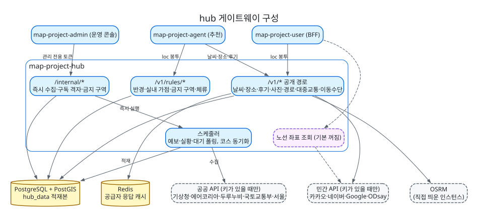

# 아키텍처

map-project-hub 는 MAP 의 외부 데이터 게이트웨이다. 관광·날씨·장소·경로·이동수단 자료를 외부 API 에서 받아 정해진 모양으로 바꾸고, 다른 서비스(사용자 BFF·추천 에이전트·관리 콘솔)에 HTTP 로 내준다. 다른 서비스는 외부 API 를 직접 부르지 않고 이 서비스를 거친다.

<picture>
  <source media="(prefers-color-scheme: dark)" srcset="diagrams/gateway-dark.svg">
  
</picture>

## 1. 요청 처리 순서

1. **가드** — `/v1/*` 는 `public_guard`(`map_project_hub/routers/guards.py`): `HUB_AUTH_ENFORCED=true` 일 때만 헤더 `X-Internal-Token` 을 `MAP_PROJECT_INTERNAL_SERVICE_TOKEN` 과 상수 시간 비교한다(불일치 401). `/internal/*` 는 `internal_admin_guard`(`map_project_hub/routers/internal_router.py`): 사설 대역(`HUB_INTERNAL_TRUSTED_CIDRS`)에서 온 요청이고, 관리 전용 토큰 `MAP_PROJECT_HUB_ADMIN_INTERNAL_TOKEN` 이 설정돼 있으며 일반 토큰과 다르고, 헤더가 그 값과 같아야 한다(아니면 403). `/health`·`/health/ready`·`/metrics` 는 가드 밖이다.
2. **좌표 봉투 열기** — 좌표가 담긴 요청은 `loc` 하나로 온다. `map_project_hub/routers/location_params.py` 가 AES-GCM 봉투를 열고(`map_project_hub/crypto/location_seal.py`), 열어 본 좌표가 국내 범위(위도 33~43, 경도 124~132)인지 다시 본다. 봉투가 없거나 열 수 없거나 범위 밖이면 400 이다. 평문 좌표를 받는 길은 없다.
3. **조회** — 자료마다 아래 세 층 가운데 하나 이상을 쓴다.
   - **Redis 캐시**: 외부 API 응답을 키별 TTL 로 담는다(장소·주소·후기·사진 식별자·경로·대중교통·따릉이·킥보드).
   - **PostGIS 적재본**(`hub_data` 스키마): 스케줄러가 미리 받아 둔 예보·실황·대기·코스와, 관리 콘솔이 관리하는 구독 격자·금지 구역. 날씨 조회는 요청 시점에 발급처를 부르지 않고 적재본만 읽는다.
   - **외부 API**: 키가 설정된 공급자만 부른다. 키가 비어 있으면 그 공급자를 부르지 않고 '조회 불가'로 답한다.
4. **응답** — 공급자 실패는 성공 모양의 빈 값으로 바꾸지 않는다. 경로마다 `status`(`ok`·`partial`·`not_found`·`unavailable` 등) 또는 503 으로 구분한다. 주변 장소(`/v1/places/nearby`)는 요청 좌표가 드러나는 응답이라 응답도 봉투(`{loc}`)로 감싼다.

## 2. 모듈 역할

| 경로 | 역할 |
|---|---|
| `map_project_hub/main.py` | FastAPI 앱, 기동 검사, 공급자 클라이언트 생성, 스케줄러 시작·종료, `/health`·`/metrics` |
| `map_project_hub/config.py` | 환경변수 설정(`HUB_` 접두, 공용 값은 `MAP_PROJECT_` 이름) |
| `map_project_hub/routers/hub_routers.py` | 공개 조회 경로(날씨·장소·후기·사진·경로·대중교통·이동수단), 캐시 키 규칙 |
| `map_project_hub/routers/rules_router.py`, `map_project_hub/rules/rule_engine.py` | 외부 호출 없는 결정적 규칙(이동수단 반경, 실내 가점, 금지 구역, 체류 시간) |
| `map_project_hub/routers/internal_router.py`, `internal_admin_router.py` | 관리 콘솔용 내부 경로(예보 즉시 수집, 구독 격자 켜고 끄기, 금지 구역 CRUD) |
| `map_project_hub/routers/location_params.py`, `map_project_hub/crypto/location_seal.py` | 좌표 봉투 열기·감싸기 |
| `map_project_hub/clients/hub_clients.py` | 외부 API 어댑터(기상청·에어코리아·카카오·네이버·Google·ODsay·서울 따릉이·국토교통부 PM·두루누비·OSRM) |
| `map_project_hub/scheduler/` | 예보·실황·대기 폴링, 신선도 감시, 하우스키핑, 코스 동기화, 키 확인(`key_guard.py`) |
| `map_project_hub/db/` | 저장소 접근, 마이그레이션 일회성 실행(`migrate.py`), 기동 시 DB 계약 검사(`schema_contract.py`) |
| `map_project_hub/place_stubs.py`, `route_stubs.py` | 명시 스텁 모드(`HUB_PLACES_STUB_MODE=true`)에서 쓰는 고정 응답 |
| `migrations/` | Alembic 리비전(선형 0001~0010)과 행정구역 격자 시드 |

## 3. 기동 순서와 기동 검사

`map_project_hub/main.py` 의 `lifespan` 이 아래 순서로 진행하고, 하나라도 실패하면 서비스가 뜨지 않는다.

1. 로깅 구성(`HUB_LOG_LEVEL`).
2. `HUB_AUTH_ENFORCED=true` 와 `HUB_PLACES_STUB_MODE=true` 를 함께 켰으면 중단.
3. 좌표 봉투 열쇠 `MAP_PROJECT_LOCATION_WIRE_KEY` 가 없거나 32바이트 base64 가 아니면 중단(생성 방법 안내).
4. `HUB_AUTH_ENFORCED=true` 인데 `MAP_PROJECT_INTERNAL_SERVICE_TOKEN` 이 비어 있으면 중단.
5. DB 계약 검사(`validate_runtime_schema`): 마이그레이션 자격(`HUB_MIGRATION_DATABASE_URL`)이 환경에 있으면 중단, 접속 역할이 `map_hub_runtime` 이 아니거나 권한이 높으면 중단, DB 의 리비전이 이미지에 든 head 와 다르면 중단.
6. 스케줄러 시작, 키가 있는 공급자 클라이언트 생성(키가 없는 공급자 이름은 경고로 한 번 남긴다), 부팅 직후 예보·실황·대기·코스 수집을 한 번 띄운다.

## 4. 스케줄러 (KST)

| 잡 | 시각 | 하는 일 |
|---|---|---|
| `kma_short` | 02·05·08·11·14·17·20·23시 10분 | 구독 격자의 단기예보 1발표분 수집(마감 `HUB_KMA_RETRY_MAX_DURATION_SEC`) |
| `kma_mid` | 06·18시 10분 | 중기 육상·기온 예보 수집 |
| `kma_short_watch` | 매시 25분 | 단기예보 폴링을 한 번 더 돌려 실패·누락된 격자만 다음 발표 전에 채운다(이미 적재한 격자는 건너뜀) |
| `kma_mid_watch` | 매시 20분 | 지금 있어야 할 중기 발표분이 없으면 다시 수집(중기 수집이 이미 돌고 있으면 그냥 둔다) |
| `kma_nowcast` | 매시 15분 | 시도 대표 격자의 초단기실황 스냅샷 |
| `airkorea_poll` | 매시 20분 | 시도별 대기오염 측정값(`HUB_AIR_POLL_ENABLED`) |
| `kma_housekeep` | 매시 5분 | 만료된 예보 삭제, 보관 기간(`HUB_WEATHER_SNAPSHOT_RETENTION_DAYS`, 기본 3일)이 지난 실황·대기 스냅샷 삭제 |
| `durunubi_sync` | `HUB_DURUNUBI_SYNC_INTERVAL_HOURS` 마다(기본 168시간) | 걷기·자전거 코스와 GPX 대표 좌표·경계 상자 갱신 |

수집 잡은 스텁 모드면 건너뛰고, 스텁 모드가 아닌데 키가 비어 있으면 처음 한 번만 경고하고 건너뛴다(`map_project_hub/scheduler/key_guard.py`). 한 격자·구역·시도의 실패는 나머지를 막지 않고 다음 라운드로 미룬다.

## 5. 데이터베이스 역할과 마이그레이션

| 역할 | 로그인 | 권한 |
|---|---|---|
| `map_hub_owner` | 없음 | `hub_data` 스키마와 그 객체의 소유자 |
| `map_hub_migrator` | 있음 | `map_hub_owner` 의 구성원. 마이그레이션 때만 `SET ROLE map_hub_owner` 로 DDL |
| `map_hub_runtime` | 있음 | 서비스용. `region_grid`·`alembic_version` 읽기, `subscribed_grids` 읽기·수정, 예보·스냅샷·장소·금지 구역 읽기·쓰기, 금지 구역 시퀀스 사용. DDL·소유 역할 전환·`public` 생성 권한 없음 |

- 역할과 권한은 `scripts/database-roles.sql` 이 만든다. 운영자(로컬은 슈퍼유저)가 실행하며 비밀번호는 넣지 않는다 — 로그인 비밀번호는 따로 설정한다. 런타임 권한은 이미 있는 테이블에만 주므로 **마이그레이션 뒤에 같은 SQL 을 다시 적용**한다. 새 테이블은 이 목록을 고치기 전까지 런타임이 쓸 수 없다(닫힌 쪽 기본값).
- 마이그레이션은 서비스와 따로 한 번 돈다: `HUB_MIGRATION_DATABASE_URL=<migrator DSN> python -m map_project_hub.db.migrate`. 이 작업은 서비스용 DSN(`HUB_DATABASE_URL`)이 함께 있으면 거부하고, 권한이 높은 로그인을 거부하며, advisory lock 으로 중복 실행을 즉시 실패시킨다. 잠금 대기 10초, 문장당 5분(`migrations/env.py`).
- 빈 DB 에서 처음 마이그레이션할 때는 0001 의 `CREATE SCHEMA IF NOT EXISTS hub_data` 가 스키마가 있어도 DB 의 CREATE 권한을 확인한다. 운영자가 `map_hub_owner` 에게 CREATE 를 잠깐 주고 끝나면 거둔다. 이 순서 전체는 `scripts/verify-postgres-contract.py`(CI `database-isolation` 잡)가 빈 PostGIS 에서 검사한다.
- 여러 서비스가 한 PostgreSQL 을 함께 쓸 때 서비스 사이 경계는 map-project-infra 의 통합 검사가 확인한다.

## 6. 외부 의존성

| 공급자 | 쓰는 곳 | 키(환경변수) |
|---|---|---|
| 기상청 단기·중기·초단기 예보 (공공데이터포털) | 날씨 수집 | `MAP_PROJECT_KMA_SERVICE_KEY` |
| 한국환경공단 에어코리아 (공공데이터포털) | 대기 수집 | `HUB_AIRKOREA_SERVICE_KEY`(비면 기상청 키) |
| 한국관광공사 두루누비 (공공데이터포털) | 걷기·자전거 코스 | `MAP_PROJECT_TOUR_API_SERVICE_KEY` |
| 카카오 로컬 | 장소 검색·주소 | `MAP_PROJECT_KAKAO_REST_API_KEY` |
| 네이버 검색(블로그) | 후기 | `MAP_PROJECT_NAVER_CLIENT_ID`·`_SECRET` |
| Google Places | 장소 사진(주소와 저작자 표시만) | `HUB_GOOGLE_MAPS_API_KEY` |
| ODsay | 지하철·대중교통 경로, 노선 좌표 | `HUB_ODSAY_API_KEY`(예비 `HUB_ODSAY_API_KEY_FALLBACK`) |
| 서울 열린데이터광장 | 따릉이 대여소 | `HUB_SEOUL_OPENAPI_KEY` |
| 국토교통부 퍼스널모빌리티 (공공데이터포털) | 공유 킥보드 | `HUB_PM_SERVICE_KEY`(비면 기상청 키) |
| OSRM(직접 띄운 인스턴스) | 도보·자전거 경로 | `MAP_PROJECT_OSRM_FOOT_BASE_URL`·`_BICYCLE_BASE_URL` |
| PostgreSQL + PostGIS, Redis | 적재본·캐시 | `HUB_DATABASE_URL`, `MAP_PROJECT_REDIS_URL` |

이 저장소는 위 서비스와 제휴하지 않았다. 각 서비스의 약관은 키를 발급받는 사람이 확인한다. 자료별 출처와 이용조건은 [data.md](data.md) 에 있다.

## 7. 타임아웃과 한도 (기본값)

| 대상 | 단일 요청 | 조회 전체 | 캐시 TTL | 한도 |
|---|---|---|---|---|
| 기상청 | 10초 | 발표분당 재시도 마감 1200초 | — (적재본) | 페이지당 1200행, 격자 사이 0.5초 |
| 에어코리아 | 1.5초 | — | 900초(실패 60초) | — |
| 카카오 | 5초 | — | 3600초 | — |
| 네이버 | 3초 | — | 21600초 | — |
| Google 사진 | 3초 | 4초 | 장소 식별자 30일(무매칭 1일) | 하루 발급 50장(`HUB_GOOGLE_PHOTOS_DAILY_MEDIA_CAP`, 0 이면 끔) |
| ODsay | 3초 | 4초 | 21600초(실패 60초) | 하루 900회(`HUB_ODSAY_DAILY_CALL_CAP`) |
| 서울 따릉이 | 3초 | 4초 | 300초(일부만 받으면 30초) | 페이지 1000행 × 5 |
| 국토교통부 PM | 3초 | 4초 | 120초(실패 30초) | 사업자당 100대 |
| 두루누비 | 10초(GPX 10초) | — | — (적재본) | 한 번에 최대 50페이지 |
| OSRM | 3초 | — | 7일 | 구간 20개, 경로점 200개 |

값은 모두 `map_project_hub/config.py` 가 기준이며 환경변수로 바꿀 수 있다([.env.example](../.env.example)).

## 8. 캐시 키 규칙

- 공급자 캐시 키는 `<공급자>:<종류>:...:<지문>` 이고 끝에 `:live` 또는 `:stub` 이 붙는다. 명시 스텁으로 채운 항목이 실제 응답으로 다시 나가지 않게 한다(`_provider_cache_key`).
- 경로·대중교통 경로 캐시 키에는 응답 모델 스키마의 지문(`_model_shape`, sha256 앞 12자)이 들어간다. 응답 모델에 필드를 더하거나 바꾸면 키가 저절로 바뀌어 옛 모양의 항목을 읽지 않는다. 노선 좌표 캐시는 발급처 원본을 그대로 담으므로 지문을 넣지 않는다.
- 경로 캐시 키에는 OSRM 그래프 판(`HUB_OSRM_DATA_VERSION`·`HUB_OSRM_GRAPH_FINGERPRINT`)도 들어가, 그래프를 바꾸면 옛 경로를 쓰지 않는다.
- 좌표는 키에 그대로 넣지 않고 정해진 자릿수로 반올림한 뒤 해시한다.
